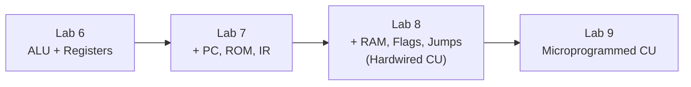

# 🖥️ Computer Architecture Lab
Logic circuit design and lab reports using **Logisim-evolution**; from a simple full adder to a microprogrammed processor.

**Logisim-evolution** • **Hardware Design** • **Sharif University of Technology**

## 📖 About the Project
This repository contains all the deliverables for the Computer Architecture Lab course. The projects follow a storyline: starting with basic computational blocks (adders, multipliers, floating-point units), moving to control-unit-based designs, and finally building a simple **8-bit computer** and upgrading its hardwired control unit to a **microprogrammed** one.

All circuits are implemented in Logisim-evolution (`.circ`), accompanied by comprehensive Persian reports (`.pdf`) typeset in LaTeX.

## 🎓 Course Information
| Attribute | Details |
| :--- | :--- |
| **University** | Sharif University of Technology |
| **Department** | Computer Engineering |
| **Course** | Computer Architecture Lab (Fall 2024) |
| **Professor** | Dr. Sarbazi-Azad |
| **Tools Used** | Logisim-evolution (v4.1.0), LaTeX |

## 📂 Repository Structure
Each experiment is located in a numbered folder with a consistent layout:
*   `Circuit/`: Contains the Logisim project and memory hex files.
*   `Report/`: Contains the PDF report and relevant simulation images.

## 🧪 Experiments Overview

| Lab | Title | Type | Core Concept |
| :--- | :--- | :--- | :--- |
| **1** | **BCD Adder** | Combinational | 3-digit decimal adder with +6 correction. |
| **2** | **Carry-Select Adder** | Combinational | 6-bit adder reducing propagation delay using multiplexers. |
| **3** | **Fixed-Point Multiplier** | ASM + Datapath | Sequential Shift-and-Add multiplier (Q2.2 × Q2.2 → Q4.4). |
| **4** | **Floating-Point ALU** | ASM + Datapath | 32-bit IEEE-754 adder/subtractor with normalization. |
| **5** | **BCD to Binary** | ASM + Datapath | Converts 3-digit BCD to 10-bit binary via shift-and-correct (-3). |
| **6** | **ALU & Registers** | Datapath | 8-bit ALU (add/sub) with four registers and 6-bit instructions. |
| **7** | **Stored Program** | Datapath + Fetch | Adding PC, ROM, and IR to execute a Fibonacci sequence. |
| **8** | **Harvard Architecture**| Hardwired CU | Adding Data RAM, status flags, and conditional jumps. |
| **9** | **Microprogrammed CU**| Microprogrammed | Replacing Lab 8's CU with a 256×11 micro-memory & µPC. |

## 🧠 The 8-bit Computer Evolution (Labs 6 to 9)
Labs 6 through 9 iteratively build a fully functional 8-bit processor:

**Final Machine Specs:** 8-bit datapath, 4 general-purpose registers (R0–R3), Add/Sub ALU with flags (C, Z, S, O), 32-word Program ROM, 32-byte Data RAM, and 8-bit instructions.

## 🚀 Getting Started
1. Install [Logisim-evolution](https://github.com/logisim-evolution/logisim-evolution).
2. Open the `.circ` file for the desired experiment. The top-level circuit is always named `main`.
3. **Combinational Labs (1-2):** Simply toggle the input pins and observe the outputs.
4. **Sequential Labs (3-5):** Set inputs, press `Rst`, set `Start` to 1, and enable the clock (`Simulate -> Ticks Enabled`).
5. **Computer Labs (6-9):** Press `Rst`/`Clr` and start the clock. Programs are automatically fetched from the ROM.
   * *Note:* To run the tests, right-click the ROM/RAM components and select `Load Image...` to load the provided hex files (`EPROM`, `TestA`, `TestB`, `Micro_Memory`).

## 👥 Authors
*   **Amirshayan Soleimani Nia** — [@shayan24soley85](https://github.com/your-username)
*   **Mohammadmahdi Moradi** — [@mahdi0x06](https://github.com/mahdi0x06)
